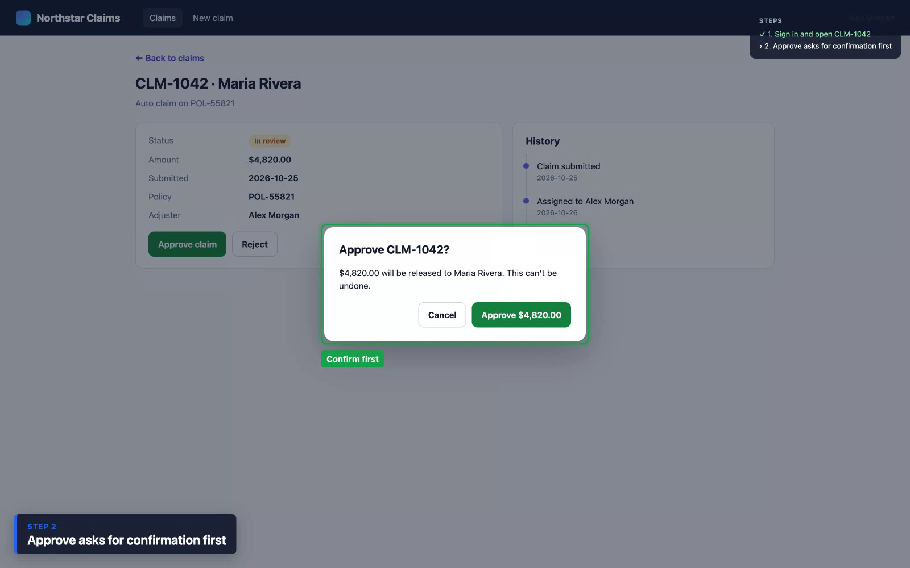
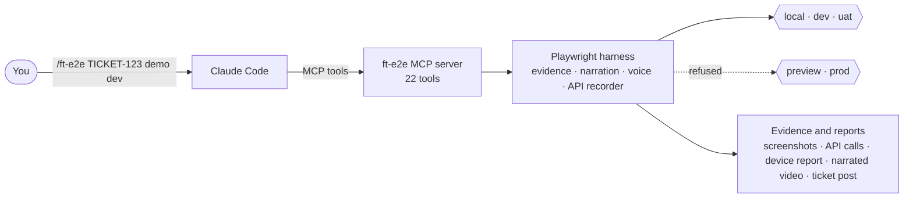
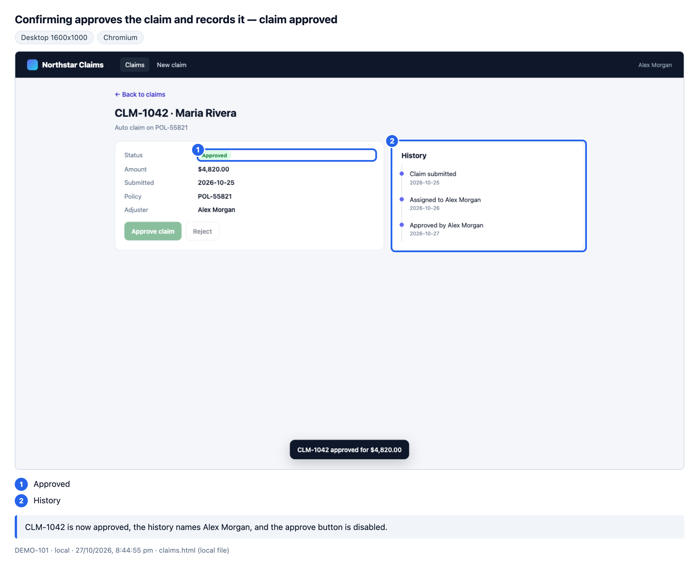
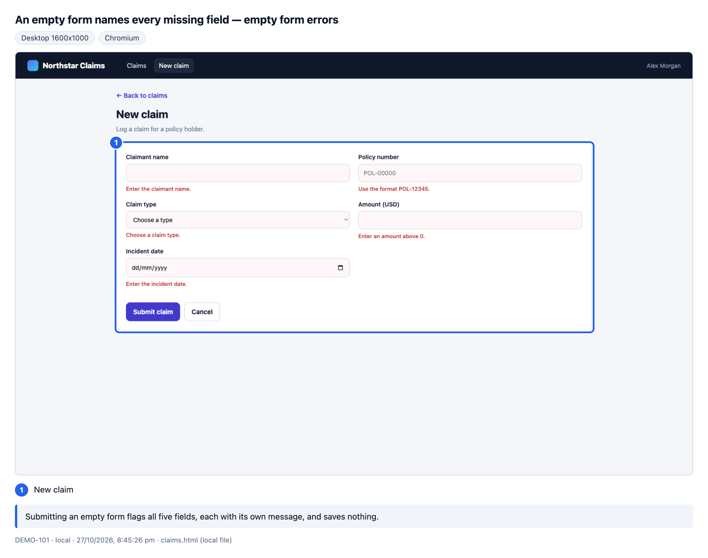
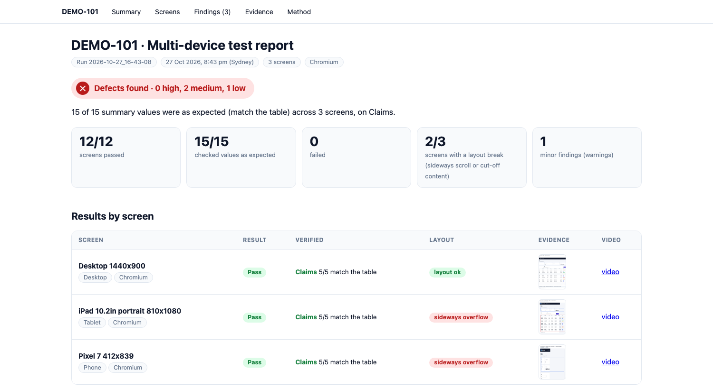
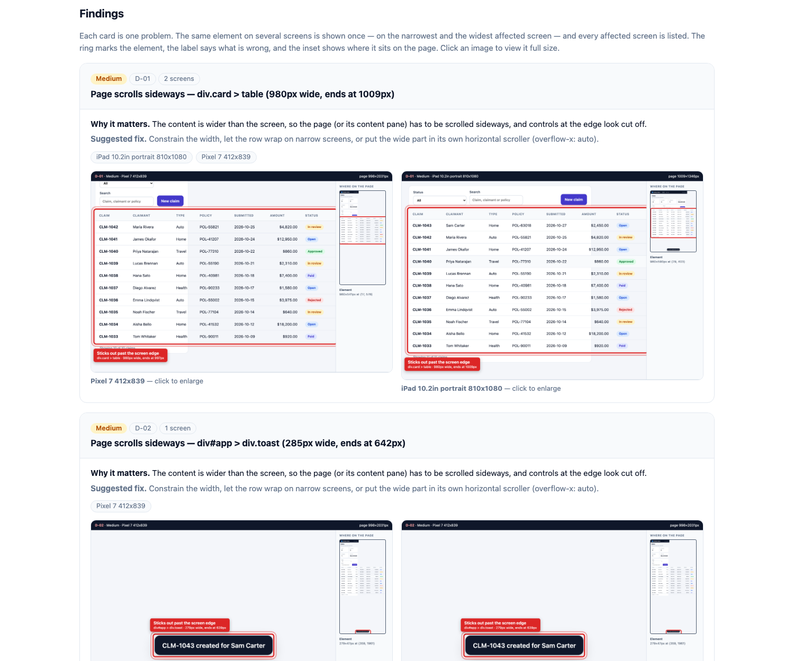

# ft-e2e

**End-to-end testing for a ticket, driven by Claude Code.**

ft-e2e is an MCP server and a Playwright harness. You type one command in Claude Code, and it:

- writes test scenarios from the ticket, for you to review
- turns them into Playwright tests
- runs them on your environments and screen sizes
- hands back the proof: annotated screenshots, a device report, and a narrated video with voice

[](docs/media/ft-e2e-demo.mp4)

▶ **[Watch the 4-minute demo, with voice](docs/media/ft-e2e-demo.mp4)** (MP4, 9 MB). Everything in it is a real run of this repo.

```
/ft-e2e TICKET-123 demo dev
```

---

## Contents

- [Why I built it](#why-i-built-it)
- [How it works](#how-it-works)
- [See it on a demo app](#see-it-on-a-demo-app)
- [What a run produces](#what-a-run-produces)
- [Quick start](#quick-start)
- [Commands](#commands)
- [Safety on shared environments](#safety-on-shared-environments)
- [Writing a spec](#writing-a-spec)
- [MCP tools](#mcp-tools)
- [Pointing it at your app](#pointing-it-at-your-app)
- [Project layout](#project-layout)
- [Known gaps](#known-gaps)

## Why I built it

When a feature is finished, proving that it works is still manual work:

- someone writes the test cases from the ticket
- clicks through them on a few screen sizes and browsers
- collects screenshots and recordings
- posts it all on the ticket

Then customer success asks for a demo, and someone does it all again.

I built ft-e2e for my team's web app, an insurance SaaS, so a finished ticket can be verified, documented and demo-ready from one command. The same output serves three people:

- **the engineer** gets proof the change works on the environment it shipped to
- **the reviewer** gets annotated evidence on the ticket instead of "tested locally"
- **customer success** gets a narrated video they can show without a live demo

## How it works



Claude Code does the thinking: it reads the ticket, drafts scenarios, writes specs and summarises results. The MCP server does the work:
- runs Playwright with guard rails
- records evidence
- audits layouts
- builds videos
- prepares the ticket post

The CLI (`bin/ft-e2e-run.mjs`) calls the same functions, so the CLI and the MCP tools always agree.

### The workflow

| Step | Command | What happens | Who decides |
|---|---|---|---|
| 1 | `scenarios` | Reads the ticket, its commits and the repo's test docs, then writes `SCENARIOS.md`: one row per case, with preconditions, steps, expected results and a control case | **You review it** |
| 2 | `spec` | Turns the approved scenarios into a Playwright spec. Selectors come from the live page (`inspect_page`), not guesses. Tried on one screen | |
| 3 | `preflight` | Checks the web app, API health, the commit that is live, the test user and the session. Changes nothing | |
| 4 | `run` / `demo` / `devices` / `browsers` | Runs the cases signed in, on one or many screens and engines, narrated if asked | |
| 5 | `evidence` / `video` | Annotated screenshots, recorded API calls, `EVIDENCE.md`, a device report, one narrated report video | |
| 6 | `publish` | Prepares a PDF, images, an MP4 and a comment for the ticket, shows you the exact payload, posts only after your yes | **You approve it** |

## See it on a demo app

`harness/tests/DEMO-101/` holds **Northstar Claims**, a small claims desk built for this demo (one HTML file, no backend). It has:
- sign-in with error handling
- summary counts, a status filter and search
- an approval behind a confirm dialog
- a new-claim form with validation

It also has one layout fault planted on purpose, so the device audit has something to find.

It runs on any machine, with no app, stack or login:

```bash
node bin/ft-e2e-run.mjs run --ticket DEMO-101 --env local --demo --skip-preflight      # narrated, with voice
node bin/ft-e2e-run.mjs run --ticket DEMO-101 --env local --devices desktop,tablet,mobile --skip-preflight
node bin/ft-e2e-run.mjs demo-video --ticket DEMO-101 --env local                         # one report video
```

| Case | What it checks |
|---|---|
| TC-01 | A wrong password is refused; the right one opens the desk; the 4 summary counts match the 10 claims |
| TC-02 | Status "In review" leaves exactly 3 claims, all in review; searching "Rivera" finds CLM-1042 only |
| TC-03 | Approve asks for confirmation; confirming marks the claim approved, records it in the history, disables the button and moves the summary counts |
| TC-04 | An empty form flags all 5 fields; a future incident date is refused; a valid claim is saved as open at the top of the list |

Result: **4 of 4 passed on the first run**, and **12 of 12** on desktop, iPad and Pixel 7.

### The narrated recording

With `--demo`, every case is recorded at 1600×1000 with:
- a title card
- a "Step N" caption and a checklist that ticks as steps pass
- a ring and label on every click and every checked value
- a recap at the end
- a voice that reads each step and each result


### Evidence on every check

Every `evidence.snap` saves a full-page screenshot. It rings the values that were checked and adds a note in plain words saying what was verified. In a narrated run, that note is what the voice says as the result.

| Approval recorded | Validation |
|---|---|
|  |  |

### Every screen, audited

`--devices` runs each case once per screen in its own emulated session, and audits every screenshot for layout problems:
- **Break:** the page scrolls sideways.
- **Cut off:** a container hides content that can't be scrolled into view.
- **Warning:** touch targets under 24×24 px, or text under 12 px on phones.



On DEMO-101 the audit found three defects, each with the element, why it matters, a suggested fix and the screens it breaks on:
- **The planted one:** a claims table too wide for small screens (iPad and Pixel 7, not desktop).
- **Two I didn't plant:** the confirmation message pushed past the edge of the phone screen, and a back link too small to tap comfortably.



## What a run produces

Each run gets its own folder, `harness/tickets/<ticket>/evidence-<env>/runs/<date-time>/`, which later runs never overwrite:

| File | What it is |
|---|---|
| `EVIDENCE.md` | The result, the commits that were live, every case with its steps and notes |
| `artifacts/*/NN-<name>.png` | Annotated full-page screenshot per check (plus a clean `.raw.png`) |
| `artifacts/*/video.webm` | The browser recording of each case |
| `artifacts/*/voice.json` | Narrated runs: each spoken line, timed to its recording |
| `report.webm` | All cases in one video, with a title card, a chapter per case, a voice track and a result card |
| `devices.html` | Case × screen matrix and the layout findings, ranked by severity |
| `report/` | Playwright's own HTML report and traces |

### Voice narration (macOS)

A demo run reads each case title, step, evidence note and recap aloud with the macOS speech engine. The page waits for each line to finish, so lines never overlap and the timing in the video is exact. `build_demo_video` mixes the lines into an Opus audio track and reads the title and result cards too.

- `E2E_VOICE_NAME` picks the voice (default `Samantha`). Download "Ava (Premium)" in System Settings → Accessibility → Spoken Content for a natural one.
- `E2E_VOICE_RATE` sets the pace in words per minute (default 185).
- `--silent` (or `voice: false`) gives a narrated run without sound.

## Quick start

**You need:** macOS (Linux works except the voice), Node 18 or later (22 recommended), [Claude Code](https://claude.com/claude-code), and ffmpeg from Homebrew for the report video (`/ft-e2e setup` can install it). The installer adds Playwright's browsers.

```bash
git clone https://github.com/shine8888/e2e-mcp.git
cd e2e-mcp
bash install.sh                       # npm install, browsers, register the MCP, install /ft-e2e
bash install.sh --fintary ~/code/app  # also wire the app's checkout (local stack, sign-in scripts)
```

The installer does the following, and is safe to re-run:
- runs `npm install` for the server and the harness
- downloads Playwright's Chromium and WebKit, plus ffmpeg
- registers the server with `claude mcp add ft-e2e -s user -- node <this folder>/src/index.mjs`
- copies the `/ft-e2e` command and its `/ft-e2e:<step>` shortcuts into `~/.claude/commands/`

Options: `--scope user|local|project`, `--skip-browsers`, `--dry-run`. **Restart Claude Code afterwards**, or reconnect with `/mcp`.

Then, in Claude Code:

```
/ft-e2e doctor                 # what is missing, per feature, with the exact fix
/ft-e2e DEMO-101 demo local    # the demo app, narrated, no setup needed
```

To run against your app's environments, add a test user per environment in `harness/.env.<env>`. These files are gitignored and never printed. Start from `harness/.env.example`:

```bash
E2E_EMAIL=<a test user, never your own login>
E2E_PASSWORD=<its password>
E2E_ACCOUNT_ID=<the test account the app should open on>
```

To publish to Linear, store a personal API key in the Keychain:

```bash
security add-generic-password -s ft-e2e-linear -a <your email> -w
```

## Commands

Write the ticket, what to do and where, in any order. Every answer ends with the next commands, ready to copy.

| Command | What it does |
|---|---|
| `/ft-e2e TICKET-123` | Preflight, what is live, the last run, next steps |
| `/ft-e2e TICKET-123 scenarios dev` | Ticket + commits + test docs → `SCENARIOS.md`, then stops for your review |
| `/ft-e2e TICKET-123 spec dev TC-01,TC-02` | Writes the spec from the scenarios and tries it on one screen |
| `/ft-e2e TICKET-123 run dev` | Every case on desktop Chromium |
| `/ft-e2e TICKET-123 demo dev` | Narrated run with voice, then one report video (`--silent` for none) |
| `/ft-e2e TICKET-123 devices dev phones,tablets` | Every case on each screen, with the layout audit |
| `/ft-e2e TICKET-123 browsers dev safari iphones` | Every case in WebKit, Firefox, Chrome or Edge |
| `/ft-e2e TICKET-123 evidence dev <run>` | Results, failures and screenshots of a run. Runs nothing |
| `/ft-e2e TICKET-123 publish dev <run>` | Prepares the ticket post, shows it, and waits for your yes |
| `/ft-e2e inspect /orders dev` | Live selectors on a page, for writing a spec |
| `/ft-e2e doctor` · `setup` · `stack up` · `tickets` · `report` | Toolkit check, safe installs, local stack, every ticket, roll-up |

Flags: `--writes` also runs cases that change data. `--demo` narrates `devices` and `browsers` runs. `--silent` drops the voice.

The same steps from a terminal:

```bash
node bin/ft-e2e-run.mjs preflight --env dev --ticket TICKET-123
node bin/ft-e2e-run.mjs run       --env dev --ticket TICKET-123 [--demo] [--writes]
node bin/ft-e2e-run.mjs run       --ticket TICKET-123 --devices phones --browsers all
node bin/ft-e2e-run.mjs run       --ticket TICKET-123 --api
node bin/ft-e2e-run.mjs demo-video --ticket TICKET-123
node bin/ft-e2e-run.mjs publish   --ticket TICKET-123 [--yes]
node bin/ft-e2e-run.mjs doctor
```

## Safety on shared environments

- **Production is off limits.** Environments that share production data are declared but refused for runs; they can only be probed with GET requests.
- **Writes to production are blocked** in every browser context, whatever the page asks for.
- **Data changes are opt-in.** Cases tagged `@writes` are left out unless a run asks for them, and only belong on dedicated test accounts with prefixed test data.
- **Posting needs a yes.** `publish_to_linear` only accepts the exact payload you were shown (checked by digest), and never changes the issue's status, labels or assignee.
- **Secrets stay local.** Passwords, tokens and session files are never printed. Recorded API calls are scrubbed of credentials and card data. Sessions are written with `0600` permissions.

## Writing a spec

```ts
import { appTest as test, expect } from '../../fixtures'

test('TICKET-123 TC-01 Orders grid shows the new column', async ({ page, app, api, evidence, demo }) => {
  await test.step('Open Orders', async () => {
    await page.goto(app.url('/orders'))
    await expect(page.getByRole('columnheader', { name: 'Fulfilment' })).toBeVisible()
  })
  await test.step('The column shows each order’s status', async () => {
    const cell = page.getByRole('row').nth(1).getByRole('cell').nth(4)
    await expect(cell).toHaveText('Shipped')
    await demo.circle(cell, 'Shipped')
    await evidence.snap('fulfilment column', { mark: cell, note: 'The first order shows Shipped in the new Fulfilment column.' })
  })
})
```

- `test` opens with no session; `appTest` opens signed in, on the account in `E2E_ACCOUNT_ID`.
- `api`, `publicApi` and `apiFor` are recorded HTTP clients. Every call lands in the evidence, with secrets removed.
- `demo.circle`, `demo.point` and `demo.callout` mark results in a narrated run, and do nothing otherwise.
- Tag a case that creates, changes or deletes data with `@writes` in its title.
- See `harness/tests/DEMO-101/` for a complete example.

## MCP tools

| Tool | Read-only | What it does |
|---|---|---|
| `list_environments` | yes | The environment registry |
| `preflight` | yes | Web, API health and live commit, web build time, test user, session, local safety checks |
| `prepare` | no | Harness dependencies, the local stack, sign-in |
| `run_e2e` | no | Preflight → Playwright (scoped to a ticket) → `EVIDENCE.md` → summary |
| `get_evidence` · `list_runs` · `list_tickets` · `get_api_calls` | yes | Runs, results and recorded API calls |
| `inspect_page` | yes | Live roles, labels, input ids, grid columns, dialogs and console errors for a page, plus a screenshot |
| `list_videos` · `build_demo_video` | yes · writes | A run's recordings; one narrated report video |
| `list_devices` · `build_device_report` | yes · writes | Screens and groups; the case × screen report with findings |
| `prepare_linear_publish` · `publish_to_linear` · `linear_publish_status` | no · writes · yes | PDF, images, MP4 and comment, previewed, then posted by digest |
| `dev_stack_status` · `dev_stack_up` · `dev_stack_down` | mixed | The app's local stack, through its own scripts |
| `check_toolkit` · `install_toolkit` | yes · no | What this machine is missing, and the safe installs |
| `build_report` | writes | Cross-ticket roll-up as Markdown, HTML and JSON |

## Pointing it at your app

ft-e2e was built for one app, and its wiring is in a few places:

- **`config/environments.json`** is the single list of environments that the server, CLI and harness all read. It holds each environment's web and API URLs, whether runs are allowed, and notes.
- **`harness/lib/firebase.cjs`** handles sign-in. It goes through the web's own sign-in form (or the app repo's custom-token script on local), then saves a Playwright `storageState` with IndexedDB, where Firebase keeps the user.
- **`harness/fixtures/index.ts`** opens the app on the right account and attaches the API auth headers.

Change those three for another app; the narration, evidence, device audit, video and publishing pieces don't depend on the app.

## Project layout

```
bin/ft-e2e-run.mjs        CLI over the same functions as the MCP tools
src/index.mjs             MCP server (stdio)
src/tools/                tool definitions (zod schemas + descriptions)
src/scenarios/            run, preflight, evidence, devices, video, publish, toolkit
config/environments.json  environments: URLs, wired or refused
harness/                  Playwright harness
  fixtures/               test/appTest, evidence, demo narration, voice, recorded API clients
  lib/                    config, sign-in, devices, browsers
  scripts/                EVIDENCE.md, device report, PDF, sign-in, inspect
  tests/                  smoke tickets and DEMO-101
claude/commands/          the /ft-e2e command and its /ft-e2e:<step> shortcuts
docs/media/               the demo video and the images in this README
install.sh                install, register with Claude Code, copy the commands
test/smoke.mjs            the server's own checks (npm test)
```

## Known gaps

- Safari runs use Playwright's WebKit, not the Safari app. Firefox has no mobile emulation.
- The voice uses the macOS speech engine. On other systems the video has no sound track.
- Publishing to Linear is built and checked up to the request, but has not made a real post yet.
- The sign-in and environment wiring are specific to the app it was built for (see [Pointing it at your app](#pointing-it-at-your-app)).

---

Built with [Claude Code](https://claude.com/claude-code), the [Model Context Protocol](https://modelcontextprotocol.io), [Playwright](https://playwright.dev) and ffmpeg.
